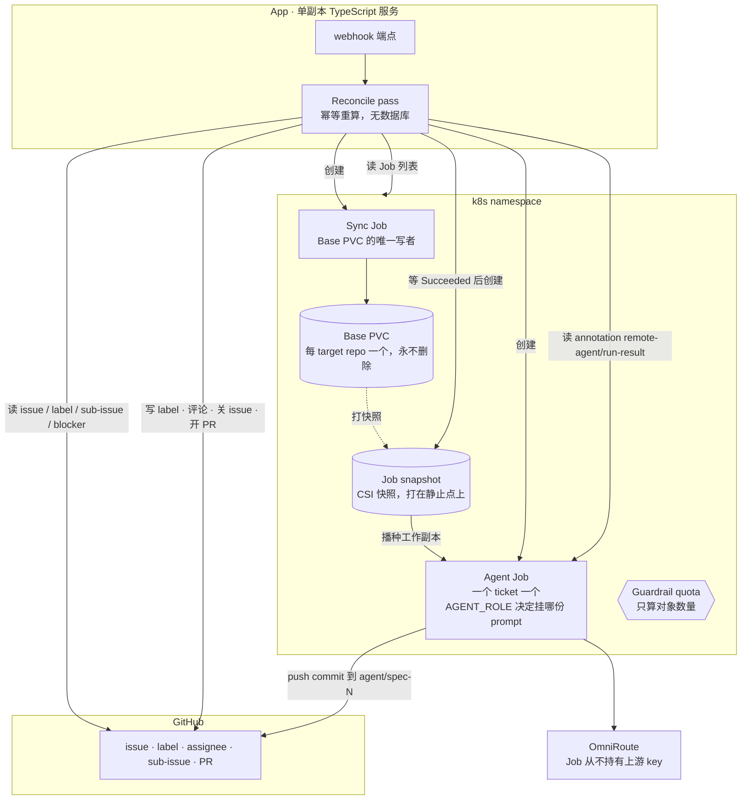
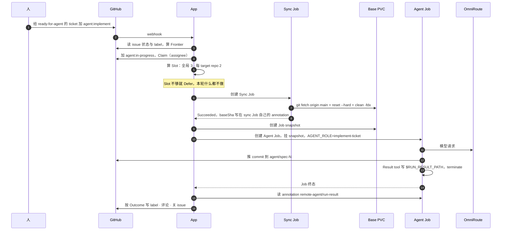
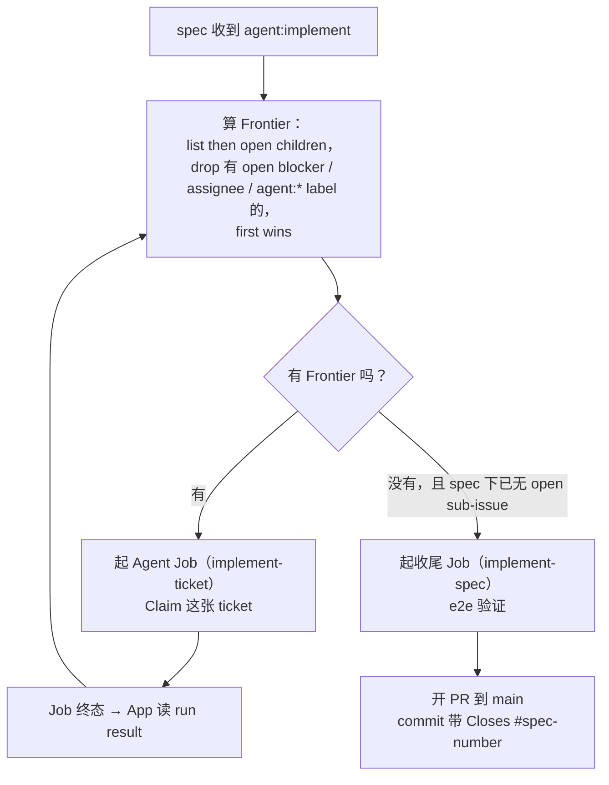
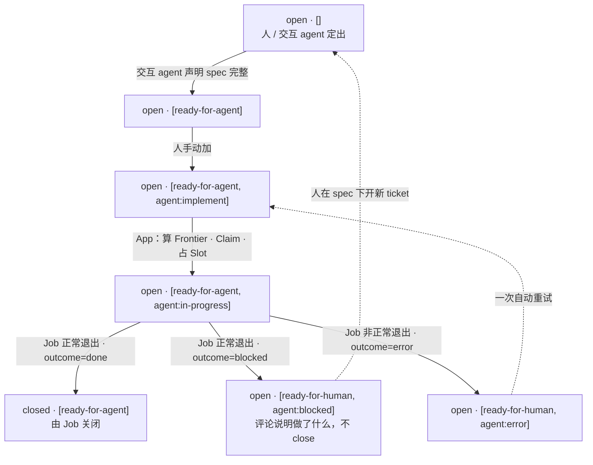
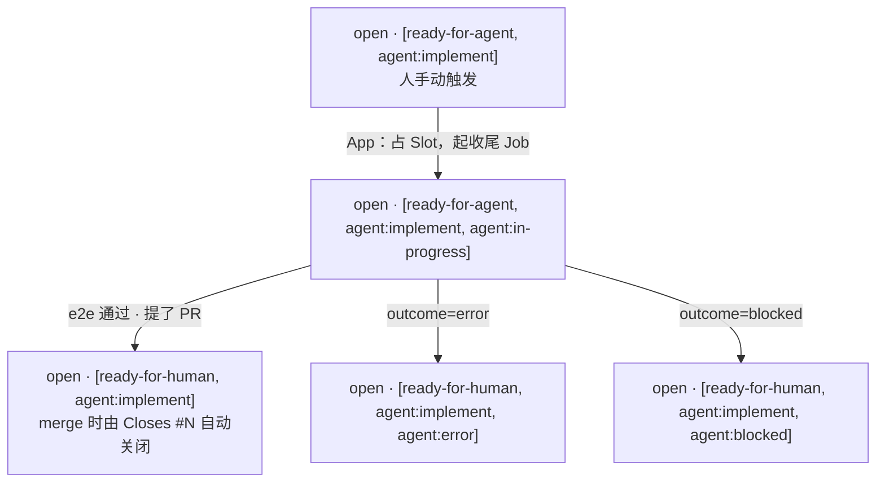
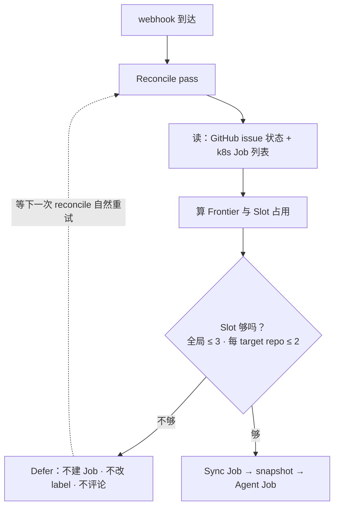
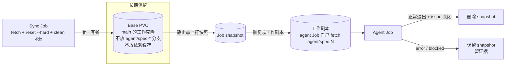
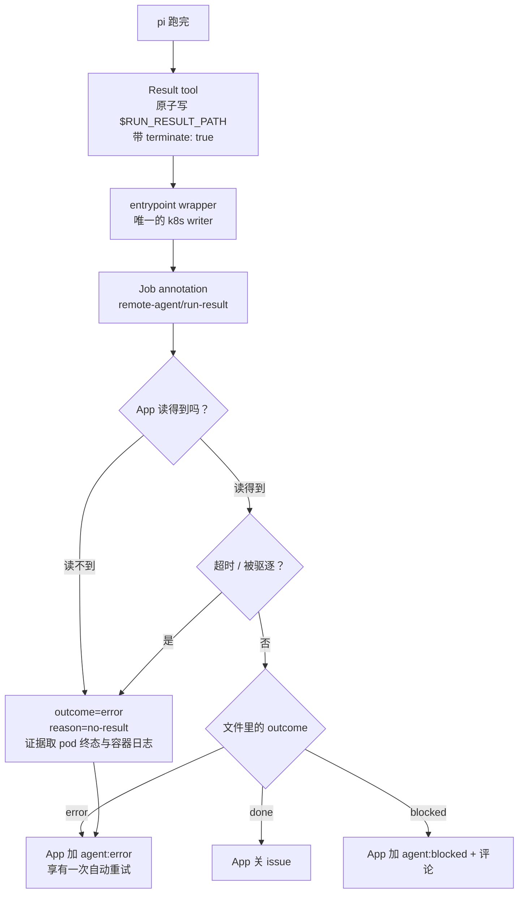
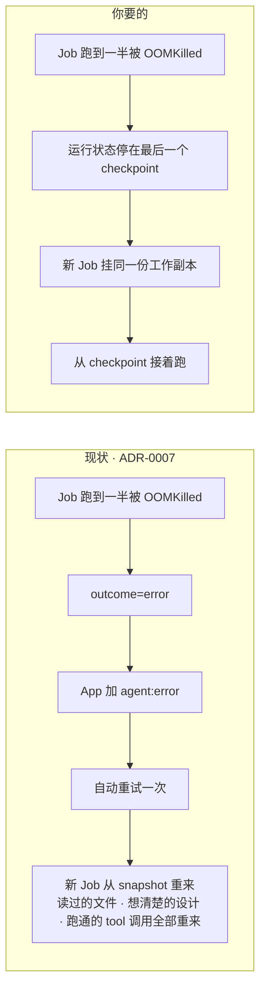

# 架构图集

本文件把**已经定下来的设计**（`README.md` + `docs/adr/`）画成图，方便对照代码与排查。

图里的名词一律取自 `GLOSSARY.md`。与 ADR 不一致的地方不在这里偷偷改，集中在[第 8 节](#8-两处缺口)列出。

## 1. 系统全景

三条边界值得记住：

- **App 是唯一的 GitHub writer**（ADR-0002）。Job 只推 commit 和写自己的 annotation。
- **Sync Job 是 Base PVC 唯一的写者**（ADR-0006）。Agent Job 只见快照，所以同步不需要排空正在跑的 Job。
- **reconcile 的触发是 webhook**，不是轮询；ADR-0001 的幂等性让"定时兜底一次 reconcile"不冲突，但不存在一个 poller 角色。

## 2. 一次 ticket 运行

同步失败直接标 `error`，**不降级用旧 base**（ADR-0006）。这是有意的：一次瞬时网络抖动废掉一次运行，比让 agent 从过期的 main 起分支便宜。

## 3. Spec 循环

Spec 不会一次性实现完。App 每收到一次运行完成，就重算 Frontier，实现下一张。

收尾 Job 判断有真阻塞时走 `agent:blocked`；判断还有活没干完时，它在 spec 下**新建 sub-issue**（AFK 可实现就带 `ready-for-agent`，否则带 `ready-for-human`），下一轮 reconcile 会把它算进 Frontier。

## 4. 状态机

### Ticket

### Spec

两边的 label 集合不一样，这是 Frontier 过滤条件的关键：ticket 进行中时 `agent:implement` **被** `agent:in-progress` **取代**，而 spec 进行中时两者**同时保留**。所以 `agent:in-progress` 出现在 spec 上不等于收尾 Job 正在跑，还要看 `agent:implement` 是否也在。

## 5. 并发：Slot 与 Defer

两个语义容易混：

- **Slot 不是 Guardrail quota**。Slot 是 App 算出来的并发名额；Guardrail quota 是 namespace 里只算对象数量的 ResourceQuota，防的是 App 逻辑写错时无限起 Job，不承载并发语义。
- **Job 只要名下还有未到终态的 pod 就占着 Slot**，无论那个 pod 是否正在终止。所以删除卡在终止的 pod 不会立刻释放名额。

## 6. Base PVC 与 Job snapshot 的生命周期

Base PVC 写坏时**不删 PVC**：按 truenas-csi 的语义，源卷被删时 `deletionPolicy: Retain` 也保不住旧快照。自愈信号是 base PVC 上的 `remote-agent/reseed` annotation（ADR-0006）。

## 7. Run result 与 Outcome 判定

`outcome` 描述**这次运行是怎么结束的**，不描述为什么没做成（后者在 `reason` 里，不进枚举、不进状态机）。

两条判定压过文件内容：**超时与驱逐压过文件里的 `done`**（被 deadline 打断的运行 commit/push 未必走完，认 done 会让 App 去 close 一个并未真正完成的 issue）；**App 对已终态但读不到 result 的 Job 兜底判 `error`**。因此 **Job 与它的 pod 在 App 成功读到 result 之前不得被删**。

用了 `terminate: true` 之后，本次 run 最后一条 assistant 消息的 `stopReason` 是 `toolUse`，所以 wrapper 判 pi 层失败只能用「最后一条 assistant 的 `stopReason ∈ {error, aborted, length}`」。

## 8. 两处缺口

以下两点是**你提的需求与现有 ADR 之间真实存在的差距**，不是实现细节。按 `docs/agents/domain.md` 的要求显式列出。

### 缺口 A：崩溃后是「重跑整个 ticket」，不是「接着之前跑」

现状由 ADR-0007 决定：一切非 agent 自述的失败（OOM、被驱逐、超时、pi 的 `stopReason ∈ error|aborted|length`）都归为 `outcome=error`，享有一次自动重试。重试是 App 起一个**新 Job、从同一份 Job snapshot 重新开始**。

要「接着跑」，需要两样现在都没有的东西：

1. **一次运行的工作副本跨 Job 存活**。现在的 Job snapshot 是一次性的，Job 结束就没有家。
2. **运行时自己的 checkpoint**。`pi -p --mode json` 没有——它是一次性的 print 运行。

触动的 ADR：**0003**（一个 ticket 一个 Job，工作副本来自一次性快照）、**0006**（快照必须打在静止的 base 上）、**0007**（`error` 的语义与重试的粒度）。

一个候选是 `@earendil-works/pi-durable`（实验性）：它把一次运行拆成 task 状态机，每步 `runtime.commit()` 落 checkpoint，进程崩溃后 `resume()` 从最后一个 checkpoint 接着跑，副作用靠 `runtime.memo()` 挡重复。代价是换掉 `pi -p --mode json` 这个运行时，ADR-0007 那套结果契约要重做——pi-durable 有自己的 submission / outcome 模型，不需要 `run_result` 工具与 annotation 那层 wrapper。

### 缺口 B：运行中无法观察，也没有介入通道

现状：App 只在 Job 终态时读 annotation。运行中你只能 `kubectl logs`，或者等它结束。ADR-0002 明确接受这个代价（「Job 不能直接跟人对话」）。

要「看到它跑到哪了、接着它之前的跑」，需要：Job 在跑的时候暴露一个可读通道，Job 不在的时候还能把它的状态读出来。这跟三条 ADR 有张力：

- **ADR-0001**：无状态 reconciler，没有地方存「哪个 ticket 现在能看到什么」的索引。任何跨 reconcile 的索引都要重新论证。
- **ADR-0002**：App 是唯一 GitHub writer。人的介入（steer、改 prompt、重跑）会成为第二个 writer，需要重新划界。
- **ADR-0007**：Job 与 pod 在 App 读到 result 之前不得被删。观察通道会延长这个保留窗口。

**这里还有一个词汇缺口**：这个能力在 `GLOSSARY.md` 里没有名字。按 `docs/agents/domain.md`，不要直接造词——留给 `/domain-modeling` 定名，再开 ADR。

## 9. 与先前草图的差异

本项目立项前的若干草图中，有三点与本仓库已定的 ADR 不符，记录在此以免混淆：

| 草图里的说法 | 与哪条 ADR 冲突 | 正确的说法 |
|---|---|---|
| control-plane 持有 `index.sqlite` | ADR-0001 无状态 reconciler | App 不保存控制面状态；GitHub issue 状态与 k8s Job 列表就是唯一真相 |
| attach pod 作为第二种 pod | ADR-0003 一个 ticket 一个 Job | 目前只有 Agent Job 与 Sync Job 两种；运行中观察是缺口 B |
| Job 通过 `onReport` 上报给 App | ADR-0002 App 是唯一 GitHub writer | Job 只推 commit、只写自己的 annotation；App 主动来读 |
| 轮询 GitHub API 作为触发 | README 已定 webhook，ADR-0001 只要求 reconcile 幂等 | 触发是 webhook；定时兜底一次 reconcile 不冲突，但没有一个 poller 角色 |
