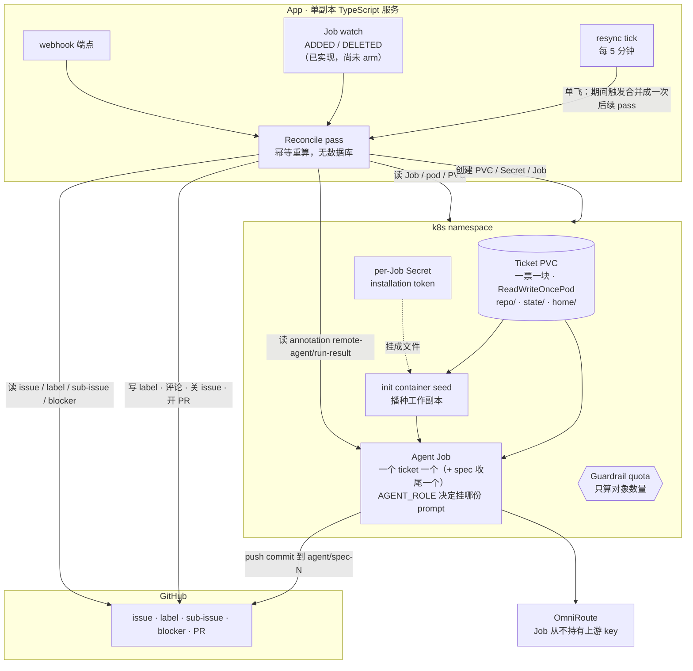
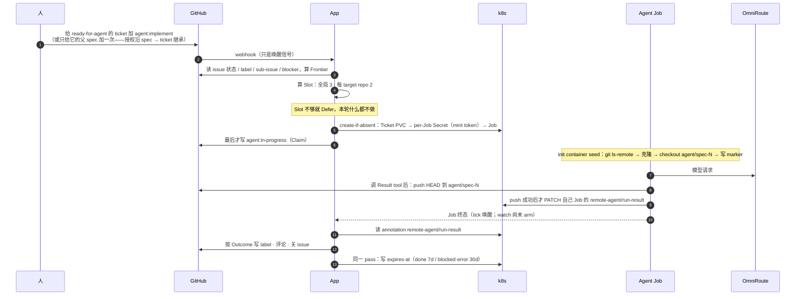
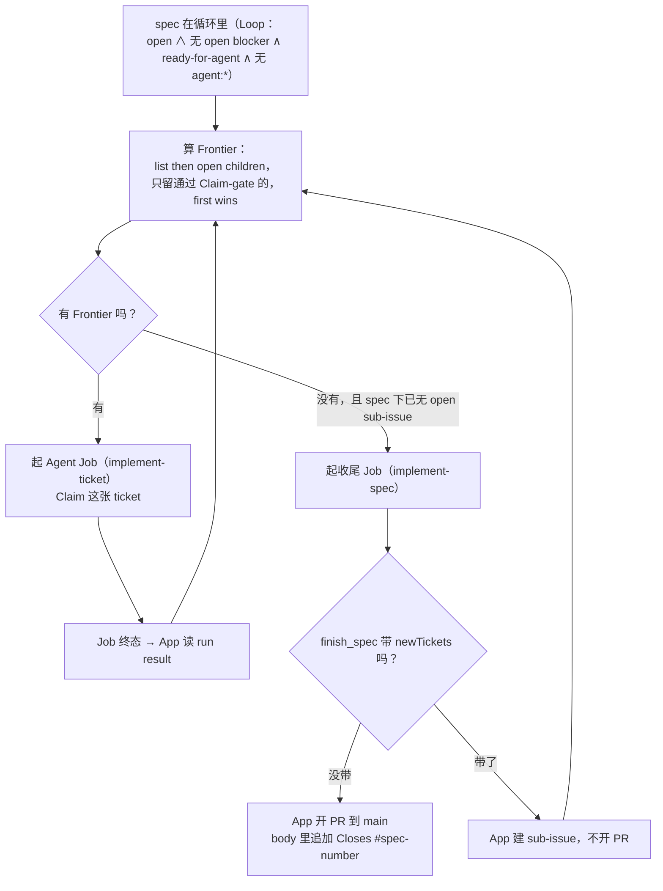
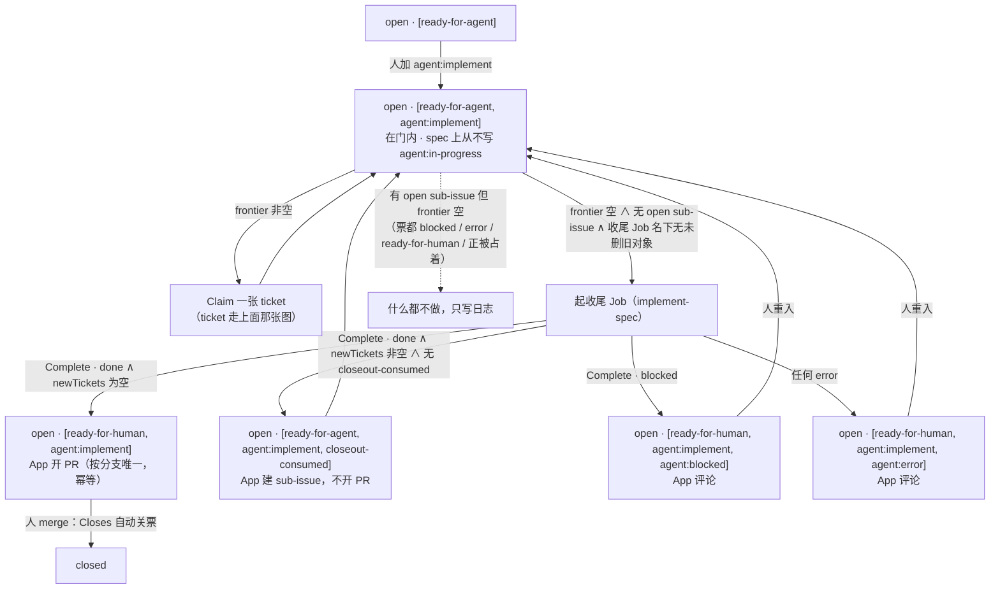
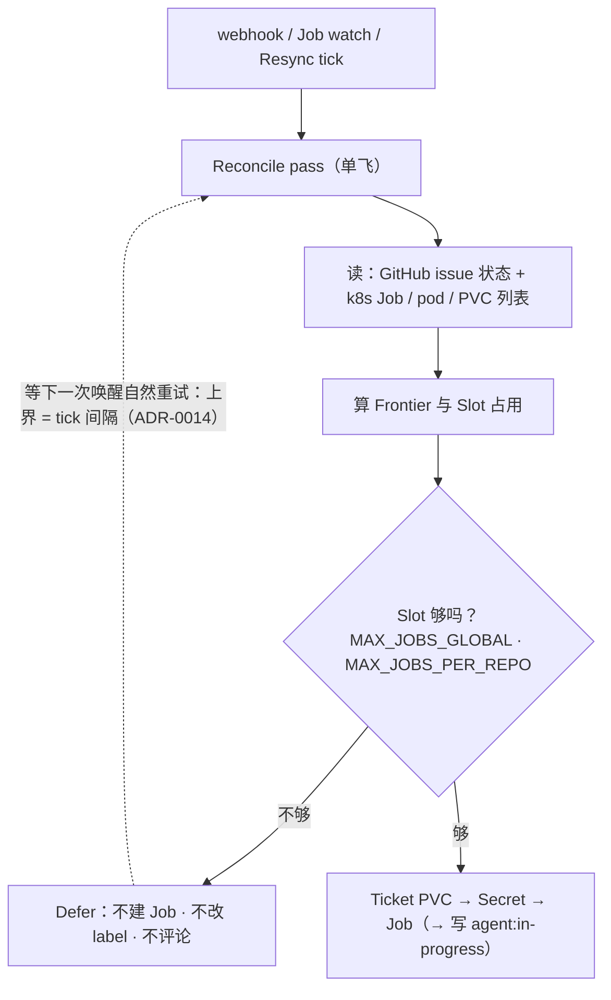
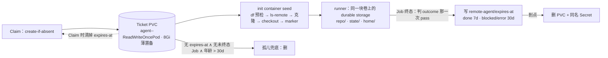
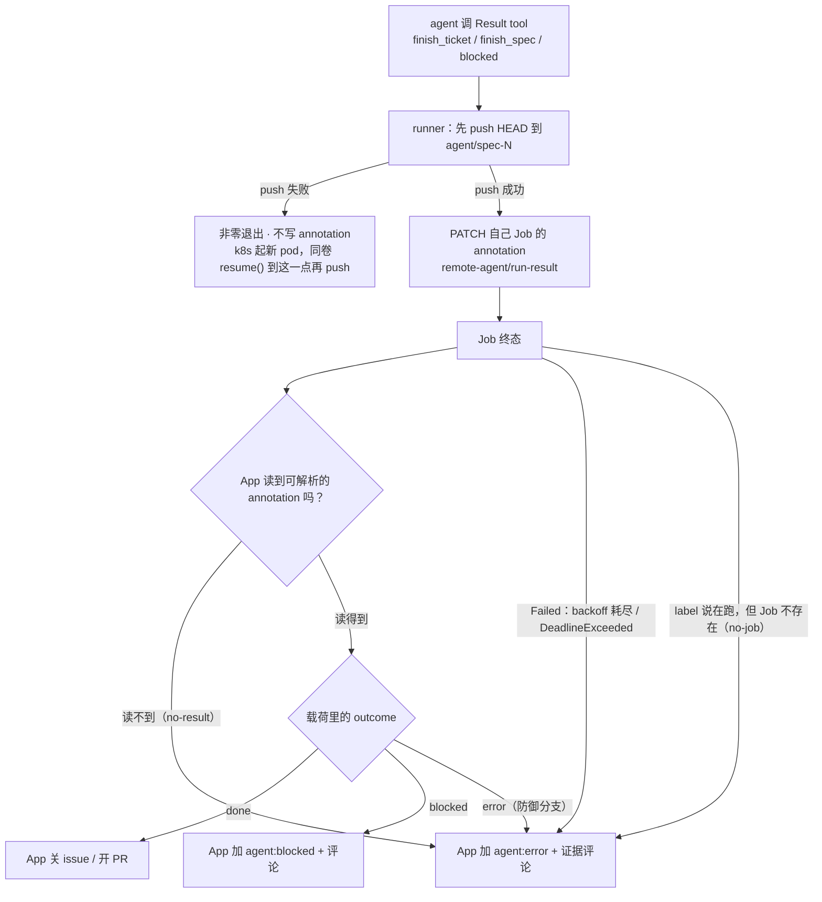
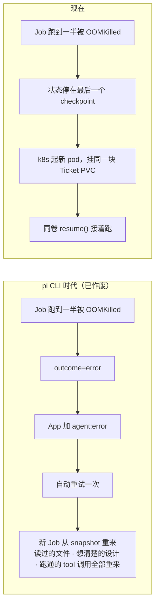

# 架构图集

本文件把**已经定下来的设计**（`README.md` + `docs/adr/`）画成图，方便对照代码与排查。

图里的名词一律取自 `GLOSSARY.md`。与 ADR 不一致的地方不在这里偷偷改，集中在[第 8 节](#8-两处缺口)列出。部署面与 OmniRoute 接线的**已定事实**（namespace、RBAC、secret、镜像、Job env、provider 接线）另在 [`docs/deployment.md`](deployment.md)，不在这里重画。

图按**已经落地的执行面**画：pi-durable（库）+ 自写 runner（[ADR-0008](adr/0008-durable-runtime-base.md)），没有 Base PVC / Sync Job / snapshot，Job 终态只有三种，pod 重启对 GitHub 不可见。交付门是 kind e2e：它已在 CI 里**required**（`push-images` 把它列进 `needs`，循环没在真集群上跑通就不发镜像），它已经抓到的 11 个生产级致命 bug 记在 [`e2e/README.md`](../e2e/README.md)。

一处**实现尚未补齐**的差异已在 §1 标出：Job watch 这条唤醒源在端口层已经实现并有测试，但 `app/src/main.ts` 还没 arm 它——目前真正在跑的唤醒源是 webhook 与 resync tick（ADR-0014 本来就把 tick 定为漏事件的兜底，所以闭环仍然成立）。

## 1. 系统全景



三条边界值得记住：

- **App 是唯一的 GitHub writer**（ADR-0002）。Job 只推 commit 和写自己的 annotation。
- **每张票一块 Ticket PVC，播种在 Job 内部**（[ADR-0009](adr/0009-ticket-volume-seeding.md)）：App 只 create-if-absent 建卷，`seed` init container 把工作副本克隆进去，`runner` 在同一块卷上跑。没有跨 repo 的共享写者，所以不存在「同步需要排空正在跑的 Job」这个问题。
- **reconcile 有三个唤醒源，不是轮询**：webhook、Job watch、resync tick 每 5 分钟一次（[ADR-0014](adr/0014-wake-surface-periodic-resync.md)）。三者都只是「去跑一轮 pass」的信号，落点都是同一个 `reconcile()`；同一时刻只跑一轮，期间的触发合并成恰好一次后续 pass；tick 不引入控制面状态（[ADR-0001](adr/0001-stateless-reconciler.md)），失败的轮不自排。Job watch 的 `DELETED` 事件就是 Claim 门 k8s 半边的唤醒源（[ADR-0013](adr/0013-claim-gates-on-job-absence.md)）。

> **实现状态（不要当成已接线）**：`K8sPort.watchJobs()` 的生产实现（`app/src/adapters/k8s.ts`，只转发 `ADDED` / `DELETED`）与 `job-watch` 这个 `Trigger` 都已存在并有测试，但 `app/src/main.ts` **没有 arm 它**——当前进程里真正会触发 pass 的只有 webhook 与 resync tick，`trigger=job-watch` 只出现在测试里。闭环因此靠 tick 兑现：ADR-0014 本来就把 tick 定为「漏接 `DELETED` 事件」的兜底，所以行为正确但延迟从秒级变成 tick 间隔（默认 5 分钟）。接上 watch 是**代码工作**，不在本文范围内。

## 2. 一次 ticket 运行



四件事是结构性的，不是实现细节：

- **写序**：PVC → Secret → Job → label（[ADR-0013](adr/0013-claim-gates-on-job-absence.md)）。在「建 Job」与「写 label」之间崩掉留下的是「Job 在跑 + 票仍在门内」，k8s 半边下一轮能收；反过来就是「in-progress + 没 Job」——一个假的 T6e。
- **push 严格先于 annotation**（[ADR-0009](adr/0009-ticket-volume-seeding.md)）：push 失败就不写结果、非零退出，k8s 起新 pod 同卷 `resume()` 到同一点再 push。所以「Job 终态但无 annotation」的卷上可能有未 push 的 commit。
- **播种失败直接判终态**：init container 的 exit 78 被 `podFailurePolicy` 映射成 `FailJob`，不等 `backoffLimit` 磨完；可重试的那类（exit 75）走普通 backoff。
- **一个 pass 只取一次 `now`**：outcome、收尾、续期、回收共用同一个判期时刻（否则一轮 straddle 边界时会刚判完就把那块卷当过期删掉）。

## 3. Spec 循环

Spec 不会一次性实现完。App 每收到一次运行完成，就重算 Frontier，实现下一张。



收尾 Job 的两件事容易被记错：

- **它不跑 e2e**。收尾 role 的验证是全量测试 + typecheck（仓库 prompt 里点名 lint 就跑）；`/implement-spec` 原文里没有 e2e，v1 不自行加（[prompt 必写项清单第 5 条](agents/prompt-checklist.md)）。代价明写：目标仓自己的 `test:e2e` 这次运行没人跑，结果交到 PR 让人看。
- **`Closes #<spec>` 不由 commit 带**，而是 App 开 PR 时追加进 PR body（幂等：已含就不重复加）。agent 不开 PR、不调 `gh`（[ADR-0002](adr/0002-app-is-sole-github-writer.md)）。

收尾 Job 判断有真阻塞时走 `agent:blocked`；判断还有活没干完时在 run result 里带 `newTickets`，App 在 spec 下**新建 sub-issue**（AFK 可实现就带 `ready-for-agent`，否则带 `ready-for-human`）且**不开 PR**——开 PR 等于宣称 spec 完整。新票只带 `ready-for-agent`、不带 `agent:implement`，但**它们下一轮就进 Frontier 并被 Claim**：授权沿 spec → ticket 继承（[§4.2](#42-frontier-与-gate)），而这个 spec 已经是人授权过的。`ready-for-human` 的新票留在门外等人——triage 从不继承。所以收尾 Job 每轮报 `newTickets`，这条循环就自己再跑一轮，中间没有人类检查点。

**S3N 的 outcome 只消费一次**（[ADR-0015](adr/0015-closeout-outcome-consumed-once.md)）。这块分支是 spec 循环里唯一**判完还留在门内**的：它的「已消费」载体原本只有它建出来的那些票——只要有一张还 open，spec 就在 S1，不会有第二轮去重判那块收尾 Job。但那个载体**会死**：新票全部关闭之后，spec 回到「无 open sub-issue」，而收尾 Job 对象还在自己的保留窗里（[ADR-0012](adr/0012-job-deletion-ttl.md)），于是同一批 `newTickets` 会被再建一遍。所以 S3N 在 spec 上留一个 label **`closeout-consumed`**：判定那一次写一次，起下一块收尾 Job 那一次清一次（与卷上的 `expires-at` 同构）。它不进 `Loop`、不挡授权继承，只是「上一块收尾 Job 的结论已经落地」的记号。

**代价：轮数无上限。** 这是「授权一次、整条 spec 跑到底」的另一面，写在这里而不是留给读者自己推：收尾 Job 每轮都可能再报 `newTickets`，没人踩刹车，一张 spec 到底要跑多少轮才收尾**不再有人类检查点兜着**。并发仍然有界——每轮仍受 `MAX_JOBS_GLOBAL` / `MAX_JOBS_PER_REPO` 约束（[§5](#5-并发slot-与-defer)），不会同时起一堆 Job——但**轮数**（以及因此累计的时间与 token）没有上界。逃生口只有两个，都在人手上：在 issue 上摘 `agent:implement`（整条 spec 立刻退出门，见 [§4.2](#42-frontier-与-gate)），或者 `kubectl delete job <名>`（只影响当前这一块）。

**另外两条代价，都明写。**

一是**每轮之间多一个等删除的间隙**：新票全部关闭之后，spec 不会立刻起下一块收尾 Job，而要等那块旧对象被 k8s 的 TTL 删掉（≤ 30 分钟）才开始下一轮。轮数无上限意味着这个间隙可以反复出现；等不及的人 `kubectl delete job <名>`，删除事件就是唤醒源（与 [ADR-0013](adr/0013-claim-gates-on-job-absence.md) 的逃逸口同一个）。

二是**两个没有载体的崩溃窗口**，标记只是把它们的代价换小了，没有关掉：

| 崩在 | 代价 | 靠什么补回 |
|---|---|---|
| 标记写完、第一张票还没建 | 这一批票全丢 | Job 被 TTL 删掉 → 起一块**新的**收尾 Job → spec role 重新报出还差什么 |
| 某张票建好、还没链接成 sub-issue | 这一批剩下的票 + 一张没人链接的孤儿票 | 同上；孤儿票在仓库里看得见，只是不在这个 spec 的 sub-issue 列表里 |

（第二种在标记出现**之前**的代价是「整批重来」——重复建票。标记让它变成「少建几张」，方向是对的，但没有变没。）要真正关掉需要 run result 里带一个幂等键，而标题去重已被否掉：猜错会静默吞掉一张真票。详见 [ADR-0015](adr/0015-closeout-outcome-consumed-once.md)。

## 4. 状态机

状态机只有**两个**能移动 label 的入口：**App 的 reconcile** 和**人的手**。第三种变化源——k8s 重启 pod——**对 GitHub 不可见**，这是本节最容易读错的地方。

### 4.1 三条硬规矩

| 规矩 | 含义 | 出处 |
|---|---|---|
| **Job 终态只有三种** | `Complete`（runner 自述 done/blocked 后已写 annotation）、`Failed(reason=BackoffLimitExceeded)`、`Failed(reason=DeadlineExceeded)`。三者之外没有「运行结束」。 | [ADR-0008](adr/0008-durable-runtime-base.md) |
| **pod 层失败不留痕** | `OOMKilled` / 驱逐 / `SIGTERM` / `CrashLoopBackOff` / init container 播种失败 → k8s 重启 pod → 同卷 `resume()`。GitHub 上**一个字都不变**。 | [ADR-0007](adr/0007-run-result-contract.md) / ADR-0008 |
| **`error` 是人的入口** | App 从不重建 Job、从不自动重试；重试的粒度是「k8s 重启 pod」，不是「App 起新 Job」。 | ADR-0008 |

App 判 Job 终态只读 `Job.status.conditions`（`Complete` / `Failed` + `reason`），**不读 pod 状态**——pod 的终态不说明任何事。「在跑」按[第 5 节](#5-并发slot-与-defer)的 Slot 口径判：Job 名下还有未到终态的 pod（`Terminating` 也算），它因此继续占着 Slot。

### 4.2 Frontier 与 Gate

```
Loop(issue) ⟺ open ∧ 无 open blocker ∧ 有 ready-for-agent ∧ 无任何 agent:*
Gate(issue) ⟺ Loop ∧ 已授权
Claim-gate(spec/ticket) ⟺ Gate ∧ 确定性名下无 Job 对象（终态与否）
Frontier(spec) = 该 spec 的 sub-issue 里第一条通过 Claim-gate 的

已授权(ticket) ⟺ 票自己带 agent:implement ∨ Gate(父 spec)
```

`Loop` 与「已授权」分开，是因为它们回答两个不同的问题：`Loop` 是「这张 issue 自己的事实说这里可以干活」，授权是「人说过可以让 agent 干」。

`Loop` 的三条各自挡一类错：

- `open` + 无 open blocker：活还没干完、依赖还没清。
- **`ready-for-agent`**：人声明过它可以 AFK。**spec 收尾后把它换成 `ready-for-human`，就是靠这一条退出门**——所以 spec 不需要 `agent:in-progress` 也能停住。
- **无 `agent:*`**：`in-progress` 说此刻被占着，`error` / `blocked` 说该人接手。三个都是 exit 标记，不是 entry 标记。

`Gate` 多出来的那一条：

- **`agent:implement`**（授权）：人授权过。「人授权过」不等于「此刻在跑」，所以 **App 永不删它**。它是唯一能从父 spec 继承的一条（下一段）。

**授权沿 spec → ticket 继承。** 一张 ticket 在门内 ⟺ 它自己带 `agent:implement`，或它的父 spec **在门内**（即父 spec 自己过得了 `Gate`，包括它自己带 `agent:implement`）。这是「给 spec 加一次 label，整个 spec 自己跑完」的实现：不必逐票点火。票自己带 label 的用法保留原样，那是「只单独实现这一张」的手动入口。

**继承只影响判定，不落到 label 上。** Claim 不在票上补写 `agent:implement`，所以票上的 label 永远只记人写过的东西，T2–T8 / S0–S6 的 label 列因此一字不改。

**只有授权能继承，`Loop` 的三条不能。** `ready-for-agent`、blocker、`open`/`closed`、exit 标记都仍是这张票自己的事实：父 spec 在门内不等于它的票都 `ready-for-agent`，也不等于它的票没有 `agent:blocked`。反过来，父 spec **自己出不了门**（缺 `ready-for-agent`、有 open blocker、带 `agent:error` / `agent:blocked`、已关）时继承不生效。

**spec 推进 sub-issue 只看 `Loop`，不看自己的 `agent:implement`**（因为它名下那张票可能自带授权）；而 spec **自己的收尾运行（S2–S5）还要 `Gate` 的那一条**——那是 spec 自己的一次运行，得由 spec 自己的授权放行。

**assignee 不在门里。** App 设不了自己当 assignee（GitHub 不保证 bot 账号可被 assign），而 Claim 本来就是「App 写 `agent:in-progress`」那一次 label edit，去重靠它 + 确定性 Job 名。assignee 留给人自己用，App 不读也不写。

**门还有 k8s 半边（[ADR-0013](adr/0013-claim-gates-on-job-absence.md)）。** 重入 / 重开后旧 Job 大概率还在自己的保留窗里（[ADR-0012](adr/0012-job-deletion-ttl.md)），create-if-absent 会撞上它：新一轮起不来，或上一轮的 annotation 被当成新结果。所以 **Claim 的门在 label 之外还看 k8s：该 ticket 确定性名下的 Job 对象还存在（终态与否），本轮就不 Claim、不建、不读那条 annotation，等它被删掉之后的下一次唤醒（设计上是 `DELETED` 事件；见 §1 的实现状态注）。** 这条「已终态旧 Job 在」⇒「annotation 已被消费」靠的是不变的消费时序：App 只在把票迁出 `agent:in-progress` 的那一次 reconcile 里读它，离开 T3 的前提就是 outcome 已消费。

等待与 Defer 同形：不改 label、不建 Job、不评论，只打一行日志；不吃 Slot（终态 Job 名下没有未到终态的 pod）。它顺带收掉两个崩窗：人在 Job 跑动中手滑摘了 `agent:*`（门内 ∧ Job 活着，最迟 3h deadline + 30min TTL 后被删，下一次唤醒重新 Claim，同卷接续）；上一次 Claim 在「建 Job」与「写 label」之间崩掉的残留（写序因此定为先建 Job 后写 label）。spec 收尾 Job（S2）同规则：`implement-spec` 名下对象还在就不起。

**逃逸口**：等不及的人可以 `kubectl delete job <名>`——Job 一没，下一轮 pass（watch 已接上时是删除事件，现在最迟是下一个 tick）就能重新 Claim，不用等满 30 分钟保留窗。

### 4.3 Ticket

| 状态 | Job 终态 · annotation | label（issue 状态） | 谁写的 | 进入条件 | 离开条件 |
|---|---|---|---|---|---|
| **T0** 人定出 | — | `open` · `[]` | 人 / 交互 agent | — | 加 `ready-for-agent` |
| **T1** 可 AFK | — | `open` · `[ready-for-agent]` | 交互 agent | T0 | 人加 `agent:implement` |
| **T2** 已授权 · 在门内 | — | `open` · `[ready-for-agent, agent:implement]` | 人 | T1，或人从 T5/T6 重入（T8） | App：Claim + 起 Job（T3）；Slot 满或名下旧 Job 未删则等（label 一字不变，只写一条日志） |
| **T3** 被占 · 跑着 | 非终态（`Pending` / `Running`） | `open` · `[ready-for-agent, agent:implement, agent:in-progress]` | App（先 create-if-absent Job、后写 label，[ADR-0013](adr/0013-claim-gates-on-job-absence.md)） | T2 ∧ Slot 够 ∧ 名下无未删旧 Job | 见 T4–T6 |
| **T3L** 自环 · pod 在重启 | 非终态（pod 重启，`resume()` 从 checkpoint 续） | **与 T3 一字不差** | k8s（无人写 GitHub） | 任何 pod 层失败 | 回到 T3，直到 Job 终态；`backoffLimit` 耗尽才走 T6b |
| **T4** done | `Complete` · `{outcome:"done", summary, commentBody?, warnings?}`（`finish_ticket` 没有 `newTickets`；App 侧代码能处理，但唯一的生产者是 `finish_spec`） | `closed` · `[ready-for-agent, agent:implement]` | App（关票、摘 `agent:in-progress`；`commentBody` 有则转成评论，`warnings` 总在最后） | T3 ∧ Complete ∧ done | 终态，出局。（防御分支：若载荷带了 `newTickets`，App 会**先建 sub-issue、再关票**——反过来会在两写之间留下「票已关、新票还没建」的空窗） |
| **T5** blocked | `Complete` · `{outcome:"blocked", commentBody}` | `open` · `[ready-for-human, agent:implement, agent:blocked]` + 评论 | App（摘 `ready-for-agent`、加 `ready-for-human`、加 `agent:blocked`、置评论） | T3 ∧ Complete ∧ blocked | 人重入（T8） |
| **T6a** error · 自述 | `Complete` · `{outcome:"error", summary}` · **无 `reason`**（防御分支：ADR-0007 下 agent 只自述 done/blocked，载荷里也没有 `reason`——细分原因是 App 证据评论的事） | `open` · `[ready-for-human, agent:implement, agent:error]` + App 评论 | App | T3 ∧ Complete ∧ error | 人重入（T8） |
| **T6b** error · backoff 耗尽 | `Failed` · `reason=BackoffLimitExceeded` · **无 annotation** | 同 T6a | App | T3L 超过 `backoffLimit` | 人重入（T8） |
| **T6c** error · 超时 | `Failed` · `reason=DeadlineExceeded` · **无 annotation** | 同 T6a | App | T3 跑过 `activeDeadlineSeconds` | 人重入（T8） |
| **T6d** error · no-result | `Complete` · annotation **缺失或不可解析** | 同 T6a | App | Job 已终态却读不到 annotation（ADR-0007 兜底） | 人重入（T8） |
| **T6e** error · no-job | Job **不存在** | 同 T6a | App | label 有 `agent:in-progress`，但确定性 Job 名在 k8s 里不存在（可用性兜底：App 宕机超过 Job 保留窗被 TTL 清掉、人手动删、灾难恢复） | 人重入（T8） |
| **T8** 人重入 | — | `open` · `[ready-for-agent, agent:implement]` | 人（摘 `agent:blocked` 或 `agent:error`，`ready-for-human` → `ready-for-agent`） | T5 或 T6a–e | 回到 T2（下一次 reconcile 重新 Claim） |

**表里的 `agent:implement` 一律读作「仅当人把它写在票上」。** 授权可以继承自父 spec（[§4.2](#42-frontier-与-gate)），而继承不落 label：一张只靠继承进门的票，每一行的 label 列里都没有 `agent:implement`，其余一字不差。这张表记的是 **App 写什么**，App 从不写、也不删 `agent:implement`。


### 4.4 那个自环：Job 在跑，票却一动不动

```
Job: Running
  └─ pod: OOMKilled / Evicted / SIGTERM / CrashLoopBackOff
       └─ k8s 拉起新 pod（同一块 Ticket PVC，ReadWriteOncePod）
            └─ runner 打开同一份 durable storage，resume() 从每个 task 的最后一个 checkpoint 接着跑
```

这条链上**没有一个环节碰 GitHub**：label 停在 `agent:in-progress`、票不开不关、没有评论；Slot 继续占着（Job 名下仍有未到终态的 pod，`Terminating` 也算）。所以从 issue 上看，它和「正在进行一次很慢的运行」完全一样——**这正是它该有的样子**：pod 的终态不是结果，Job 的终态才是。

两个具体后果：

- `CrashLoopBackOff` 期间你在 issue 上什么都看不到，唯一可见的信号是 Job 自己的 `status`（`reason=BackoffLimitExceeded` 出现前一直是 `Running`）与 pod 的 `restartCount`。要看进展只能 `kubectl get pods` / `kubectl logs`。
- **不要用 pod 的状态去修 label。** 「pod 挂了」不是 `error` 的证据，只有 Job 进终态才是；手动把一个还在自环里的票改成 `agent:error`，会让 App 去判一个仍然活着的 Job（T6e 的漂移分支），等于把人造的噪音塞进兜底路径。

### 4.5 Spec

| 状态 | Job 终态 · annotation | label（issue 状态） | 谁写的 | 进入条件 | 离开条件 |
|---|---|---|---|---|---|
| **S0** 已声明 | — | `open` · `[ready-for-agent]` | 交互 agent | — | 人加 `agent:implement`（正常路径；见下面关于「S0 也能推进一张自带授权的票」的注） |
| **S1** 循环中 · 在门内 | 本 spec 下某张 ticket 的 Job（也可能此刻没有 Job） | `open` · `[ready-for-agent, agent:implement]`，**全程不变**——spec 上从不写 `agent:in-progress`；唯一例外是 S3N 留下的 `closeout-consumed`（见那一行） | 人（只写过那一次 `agent:implement`） | S0，或人重入（S6） | 每轮 reconcile 三选一：frontier 非空 → Claim 一张 ticket（走 ticket 的 T2→T3）；frontier 空 **∧** 无 open sub-issue → 起收尾 Job（S2，若 spec 带 `closeout-consumed` 则先清标记）；有 open sub-issue 但 frontier 空（票都 blocked / error / 还差 `ready-for-agent`，或者正被一个 Job 占着）→ 什么都不做，只写日志：计进 `idle` 并打一行 `idle-spec` 说明原因（[ADR-0014](adr/0014-wake-surface-periodic-resync.md)）。**缺授权**只在 spec 自己不在 `Loop` 里时出现（S0 还没人授权，或 S4/S5 已带着 `ready-for-human` 退出）：spec 在门内时，名下任何 `ready-for-agent` 的票都继承授权，不存在「门内 spec 而票缺授权」这一格。Slot 满 → Defer。另外两支不建任何东西、只计数：收尾 Job 对象还在且 spec 带 `closeout-consumed` → 计进 `closeout-consumed`，等对象的 `DELETED`（[ADR-0015](adr/0015-closeout-outcome-consumed-once.md)）。推进 sub-issue 只看 spec 的 `Loop`（`open` ∧ 无 open blocker ∧ `ready-for-agent` ∧ 无 `agent:*`），不看它自己的 `agent:implement`；收尾才要完整的 Gate |
| **S2** 收尾中 | 收尾 Job（`implement-spec`）非终态 | 同 S1 | App（create-if-absent，确定性 Job 名） | S1 的第二个分支 | Job 终态 → S3 / S3N / S4 / S5 |
| **S3** 已开 PR | `Complete` · `{outcome:"done", newTickets:[]}` | `open` · `[ready-for-human, agent:implement]` + PR（**PR body** 末尾带 `Closes #<spec>` 与证据；commit 不带） | App（摘 `ready-for-agent`、加 `ready-for-human`、开 PR 并追加 `Closes`；PR 按分支 `agent/spec-<n>` 唯一，重复开是幂等跳过） | S2 ∧ done ∧ 无 newTickets | 人 merge → PR body 里的 `Closes` 自动关票（出局） |
| **S3N** 回填新票 | `Complete` · `{outcome:"done", newTickets:[…]}` | `open` · `[ready-for-agent, agent:implement, closeout-consumed]`（前两个不变；第三个是「这块 outcome 已消费」的标记，[ADR-0015](adr/0015-closeout-outcome-consumed-once.md)） | App（建 sub-issue，**不开 PR**；先写 `closeout-consumed` 再建票） | S2 ∧ done ∧ newTickets 非空 ∧ spec 无 `closeout-consumed` | 回到 S1；`ready-for-agent` 的新票**下一轮自动进 Frontier、自动被 Claim**（授权继承自 spec，票上不出现 `agent:implement`），`ready-for-human` 的那部分留在门外等人。新票全关之后若旧收尾 Job 还在保留窗里，spec 停在「已消费」等它的 `DELETED`（pass 日志计进 `closeout-consumed`），之后起一块**新的**收尾 Job 并清掉标记。**轮数无上限**：每轮都可能再报 `newTickets`，逃生口是人在 spec 上摘 `agent:implement`（[§3](#3-spec-循环)） |
| **S4** 阻塞 | `Complete` · `{outcome:"blocked", commentBody}` | `open` · `[ready-for-human, agent:implement, agent:blocked]` + 评论 | App | S2 ∧ blocked | 人重入（S6） |
| **S5** 出错 | `Failed(BackoffLimitExceeded)` / `Failed(DeadlineExceeded)` / `Complete` 无 annotation / Job 不存在（漂移） | `open` · `[ready-for-human, agent:implement, agent:error]` + 评论 | App | S2 ∧ 上述任一 | 人重入（S6） |
| **S6** 人重入 | — | `open` · `[ready-for-agent, agent:implement]` | 人（摘 `agent:blocked` / `agent:error`，`ready-for-human` → `ready-for-agent`） | S4 / S5 | 回到 S1 |

**S0 也能推进一张自带授权的票。** 推进 sub-issue 只看 spec 的 `Loop`（[§4.2](#42-frontier-与-gate)），所以一个还停在 `[ready-for-agent]` 的 spec，只要它名下某张票**自己**带 `agent:implement`，那张票照样进 Frontier、照样被 Claim——那是「只单独实现这一张」的入口。它因此起不了收尾 Job（收尾要 spec 自己的授权），所以 spec 会停在 S0，直到人给它加 label。



五处与旧版不同，值得记住：

1. **spec 上不再有 `agent:in-progress`。** spec 的「在跑」不是一次 Job 而是一段循环，用 label 表达它就得维护一个不进 Gate 的状态。Gate 已经够了：在门内 + frontier 空/非空就是全部信息。`agent:in-progress` 因此只有一个意思——**这张 ticket 此刻被一个 Job 占着**。
2. **ticket 的 error / blocked 不改 spec 的 label。** spec 只是因此失去 frontier，停在 S1 的空转分支；人不处理那张票，整个 spec 就停在那儿。
3. **收尾 Job 报 `newTickets` 时不开 PR**（S3N）：它在说「还有活没干完」，此时开 PR 等于宣称 spec 完整。旧 README 第 12 条只说了要建 sub-issue，没说清 PR 这一半。
4. **新票自己跑，不再等人点火**（ticket #48）。S3N 建出的 `ready-for-agent` 票在下一轮就是 Frontier、就被 Claim——它只带 `ready-for-agent`，授权是沿 spec 继承来的（[§4.2](#42-frontier-与-gate)）。旧语义里那条「有 open sub-issue 但 Frontier 空 → idle，等人补 `agent:implement`」是**逐票授权**的产物，随继承一起作废：在一个已授权的 spec 下，idle 只出现在票真的不该跑时（`agent:blocked` / `agent:error` / `ready-for-human` / 正被一个 Job 占着），而 `idle-spec` 的原因行会说是哪一个。代价是轮数无上限，见 [§3](#3-spec-循环)。
5. **S3N 的 outcome 有一个显式的消费标记**（ticket #49，[ADR-0015](adr/0015-closeout-outcome-consumed-once.md)）。S3N 是唯一判完还留在门内的分支，而它原来唯一的「已消费」载体是它建出来的票——票全关掉之后载体就没了，旧收尾 Job 却还在保留窗里，同一批 `newTickets` 会被再建一遍。现在 spec 上多一个 `closeout-consumed` label：判定那一次写、起下一块收尾 Job 那一次清。它不进 `Loop`，所以 S3N 之后 spec 的 label 集是 `[ready-for-agent, agent:implement, closeout-consumed]`——前两个照旧，第三个只是记号；它也不挡授权继承。

### 4.6 每个 error / blocked 终态都留一条评论

annotation 只有 runner 在**终态**才写，所以 T6b/T6c/T6d/T6e 这四条路上**根本没有 annotation**——人看到的就是一个光秃秃的 `agent:error`。所以 App 在这四种情况下自己发一条评论，内容固定为：

- `outcome=error` 与 App 自己判的 `reason`（`backoff-exhausted` / `deadline-exceeded` / `no-result` / `no-job`）——**`reason` 不在载荷里**（[ADR-0007](adr/0007-run-result-contract.md)：agent 不能自述 `error`），它是 App 从 Job 终态与「annotation 有没有」得出的；
- Job 名、pod 名；
- **重入提示（[ADR-0013](adr/0013-claim-gates-on-job-absence.md)）**：人重入后，若旧 Job 还在保留窗里，新一轮最迟 30 分钟内起跑；等不及可 `kubectl delete job <Job 名>`，让下一次唤醒不必等满保留窗（watch 未 arm 时那个唤醒就是下一个 tick）；
- pod 终态证据（`OOMKilled` / `exitCode` / `DeadlineExceeded`）与容器日志末尾；
- 这个 ticket 的 Ticket PVC 名（storage 里的对话全文在这儿）与 `kubectl logs` 指引，以及**这块卷的 `remote-agent/expires-at`**（[ADR-0011](adr/0011-ticket-pvc-recycling.md)：`blocked` / `error` 留 30 天）。要提醒的是卷上**可能有未 push 的 commit**——`backoffLimit` / `DeadlineExceeded` / `no-result` 三条路上 runner 可能还没 push，卷是那部分工作的唯一副本。

`blocked` 与 `done` 走 agent 自述的 `commentBody`；agent 没给 `commentBody` 时 App 退回同一份模板。**`error` 没有自动重试，这条评论就是人唯一的入口提示。**

## 5. 并发：Slot 与 Defer



两个语义容易混：

- **Slot 不是 Guardrail quota**。Slot 是 App 算出来的并发名额（`MAX_JOBS_GLOBAL` 默认 3 / `MAX_JOBS_PER_REPO` 默认 2，都是 App env 键）；Guardrail quota 是 namespace 里只算对象数量的 ResourceQuota，防的是 App 逻辑写错时无限起 Job，不承载并发语义。
- **Job 只要名下还有未到终态的 pod 就占着 Slot**，无论那个 pod 是否正在终止。所以删除卡在终止的 pod 不会立刻释放名额；反过来，保留窗里的终态 Job 名下没有未终态 pod，不占名额。

## 6. Ticket PVC 的生命周期



三条规矩：

- **`expires-at` 不存在 = 不可删**。Claim 时清掉它，判 outcome 那一次 reconcile 里 set-if-absent 写一次；所以 T3 / T3L（在跑 / pod 重启）的卷一定带着「不可删」。
- **孤儿兜底只看 k8s**：无 `expires-at` ∧ 没有任何未到终态的 Job 引用它 ∧ `creationTimestamp` 超 30 天。覆盖两类永远走不到 outcome 的卷：issue 被删 / 转走，或 App 在 Job 保留窗内没能读到结果。
- **一个 pass 内的顺序是先判后收**：label 与 `expires-at` 先落到终值，再跑回收（且回收自己重读 PVC / Job）。否则一轮 straddle 边界时会把刚打上 `expires-at` 的卷当过期删掉。

spec 的收尾 Job 同一套：自己的 Ticket PVC、同一个确定性命名规则（作用在 spec 号上）、同一条 `expires-at` 规则。回收的单位是「这块卷 + 同名的 per-Job Secret」；Job 本身归 k8s 的 `ttlSecondsAfterFinished`（[ADR-0012](adr/0012-job-deletion-ttl.md)），App 既无 Job 的 `delete` 也无 `patch` 权。

## 7. Run result 与 Outcome 判定



`outcome` 描述**这次运行是怎么结束的**，不描述为什么没做成（后者是 App 证据评论里的事，不进载荷、不进枚举）。agent 只能产生 `done` 与 `blocked`；`error` 的四种 reason（`backoff-exhausted` / `deadline-exceeded` / `no-result` / `no-job`）全部由 App 从 Job 终态与「annotation 读不读得到」推出来，第五种 `app-judged` 只服务那条防御分支（载荷里写了 `error`，而 agent 本来不能这么写）。

三条压过载荷内容的判定：

- **只有 `Complete` 分支才读 annotation，且一次 run 只读一次**（就是把它迁出 `agent:in-progress` 的那一轮）。所以一条已终态的旧 Job 不会被当成新结果重读。
- **App 对已终态但读不到 result 的 Job 兜底判 `error`**（`no-result`）。因此 **Job 与它的 pod 在 App 成功读到 result 之前不得被删**：这是 `ttlSecondsAfterFinished=1800` 的真实含义——它是 App 的读取预算（[ADR-0012](adr/0012-job-deletion-ttl.md)）。
- **pod 的终态不说明任何事**。OOMKilled / 驱逐 / SIGTERM / CrashLoopBackOff 只意味着 k8s 起新 pod、同卷 `resume()`；GitHub 上不会出现任何变化，也不会因此写 annotation（runner 只在真正终态且 push 成功后写它）。

## 8. 两处缺口

以下两点是**需求与当时 ADR 之间真实存在的差距**，不是实现细节。按 `docs/agents/domain.md` 的要求显式列出。

> 原本记在这里的第三处——S3N 建出的新票关闭后同一批 `newTickets` 会被再建一遍（[#49](https://github.com/2017fighting/remote-agent/issues/49)）——**已修**，机制是 spec 上的 `closeout-consumed` 标记（[ADR-0015](adr/0015-closeout-outcome-consumed-once.md)，行为见 [§3](#3-spec-循环) 与 [§4.5](#45-spec)）。心智模型从「收尾 Job 的 outcome 在新票关闭之后可能被消费两次」改成：**收尾 Job 的 outcome 只被消费一次，靠 spec 上的 label 记，而不是靠它建出来的票还开着**。

### 缺口 A：崩溃后是「重跑整个 ticket」，不是「接着之前跑」——**已解决**

> **已解决（[ADR-0008](adr/0008-durable-runtime-base.md)）**：执行面基座换成了 `@earendil-works/pi-durable@1.3.0`（库，无 CLI）+ 自写 runner。崩溃 / 被驱逐不再走 `error` + 起新 Job，而是 **k8s 重启 pod + 同一块 Ticket PVC 上 `resume()`** 从每个 task 的最后一个 checkpoint 接着跑。下面的描述只对 pi CLI 时代成立，保留作背景与「为什么当时不行」的记录。

当时的现状由 ADR-0007 决定：一切非 agent 自述的失败（OOM、被驱逐、超时、`stopReason ∈ error|aborted|length`）都归为 `outcome=error`，享有一次自动重试；而重试是 App 起一个**新 Job、从同一份 Job snapshot 重新开始**。



它当时缺的两样东西，现在都有了：

1. **一次运行的工作副本跨 Job 存活**：Ticket PVC 比 Job 活得久（`ReadWriteOncePod`、回收按 `expires-at`，见 §6）。
2. **运行时自己的 checkpoint**：durable 把一次 run 拆成 task 状态机，phase 边界落 checkpoint；runner 的 open 路径是统一的——**`resume()` 接中断的，`submit()` 起新的**，不需要 App 传「这是重跑还是重开」。

两条代价仍要记住（它们是这个解决方式的边界，不是缺口）：

- **崩溃的代价是 phase 重跑**：durable 只在 phase 边界落 checkpoint，且 built-in 工具（连 `read`）全是 `replay: "unsafe"`——崩在工具调用里，模型看到的是 `interrupted` 而不是重跑。
- **crash-loop 的上界由 Job 的 `backoffLimit` 给**（v1 取 4）：耗尽之后仍然是 `Failed(BackoffLimitExceeded)`，App 判 `error`，**不自动重试**——`error` 仍是人的入口。

### 缺口 B：运行中无法观察，也没有介入通道

现状：App 只在 Job 终态时读 annotation。运行中你只能 `kubectl logs`，或者等它结束。ADR-0002 明确接受这个代价（「Job 不能直接跟人对话」）。

要「看到它跑到哪了、接着它之前的跑」，需要：Job 在跑的时候暴露一个可读通道，Job 不在的时候还能把它的状态读出来。这跟三条 ADR 有张力：

- **ADR-0001**：无状态 reconciler，没有地方存「哪个 ticket 现在能看到什么」的索引。任何跨 reconcile 的索引都要重新论证。
- **ADR-0002**：App 是唯一 GitHub writer。人的介入（steer、改 prompt、重跑）会成为第二个 writer，需要重新划界。
- **ADR-0007 / ADR-0012**：Job 在 App 读到 result 之前不得被删——这条已被改写成「TTL 1800 秒 = App 的读取预算」（[ADR-0012](adr/0012-job-deletion-ttl.md)）。观察通道会延长这个保留窗口。

**这里还有一个词汇缺口**：这个能力在 `GLOSSARY.md` 里没有名字。按 `docs/agents/domain.md`，不要直接造词——留给 `/domain-modeling` 定名，再开 ADR。

## 9. 与先前草图的差异

本项目立项前的若干草图中，有四条说法与本仓库已定的 ADR 不符，记录在此以免混淆：

| 草图里的说法 | 与哪条 ADR 冲突 | 正确的说法 |
|---|---|---|
| control-plane 持有 `index.sqlite` | ADR-0001 无状态 reconciler | App 不保存控制面状态；GitHub issue 状态与 k8s Job 列表就是唯一真相 |
| attach pod 作为第二种 pod | ADR-0003 一个 ticket 一个 Job | 目前只有 Agent Job（含 spec 收尾那一张）一种；运行中观察是缺口 B |
| Job 通过 `onReport` 上报给 App | ADR-0002 App 是唯一 GitHub writer | Job 只推 commit、只写自己的 annotation；App 主动来读 |
| 轮询 GitHub API 作为触发 | ADR-0014 把 resync tick 定为第三条唤醒源 | 有周期 tick，但它只当「去跑一轮 pass」的信号：不重算、不持有状态、同一时刻只跑一轮（[ADR-0014](adr/0014-wake-surface-periodic-resync.md)） |
