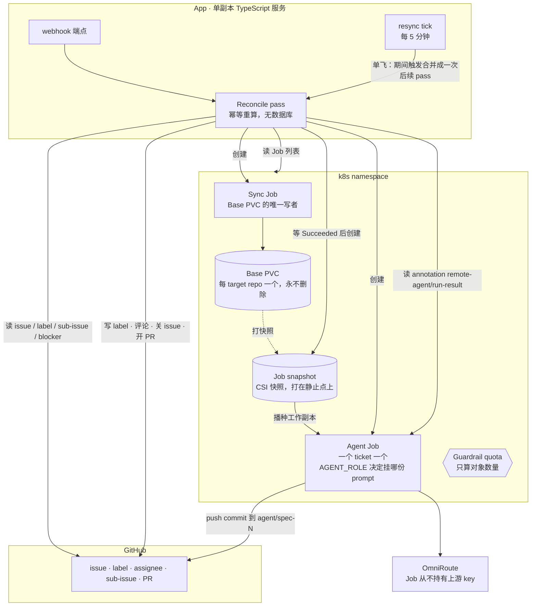
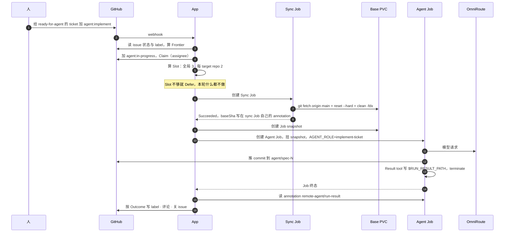
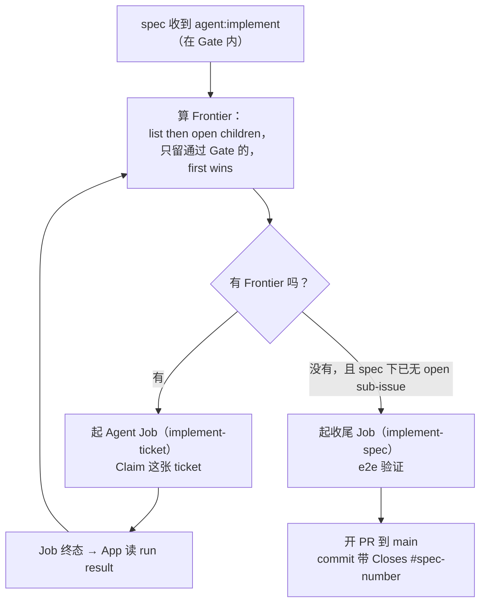
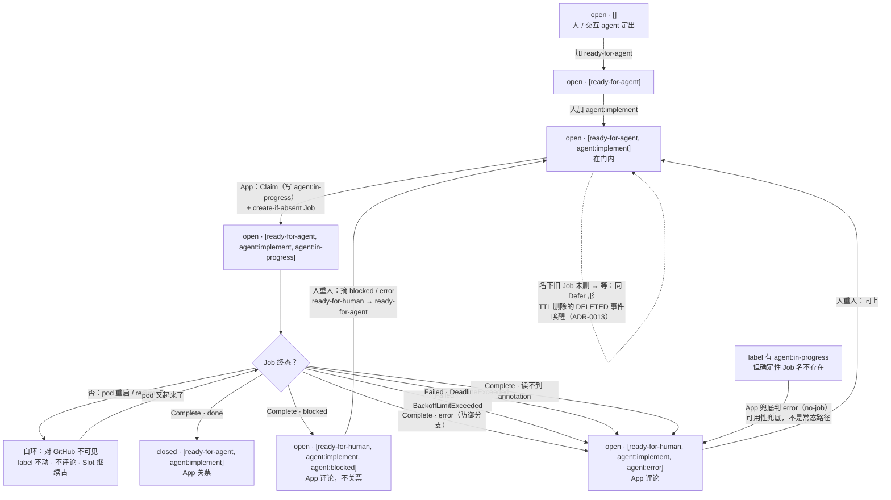
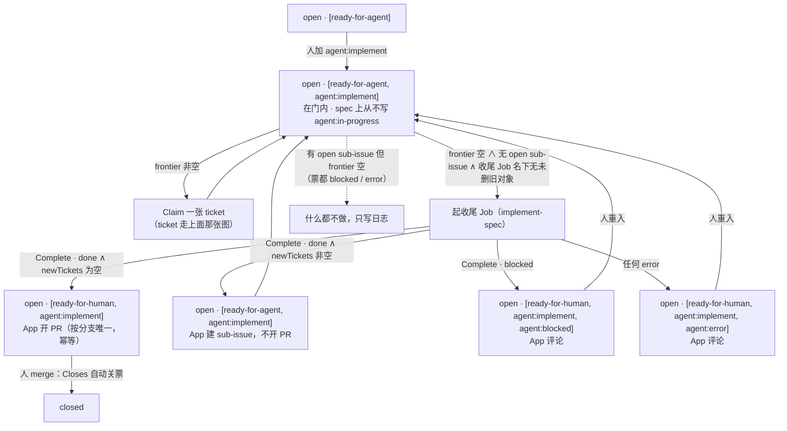
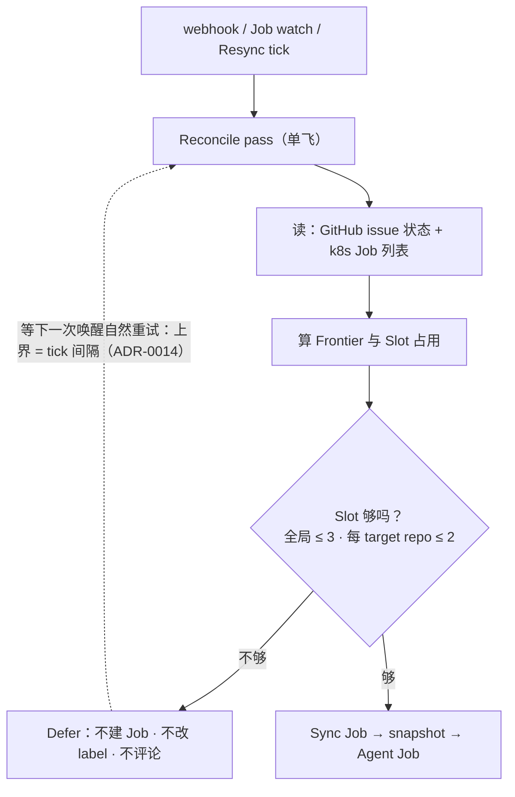
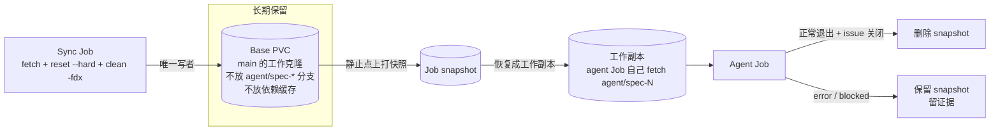
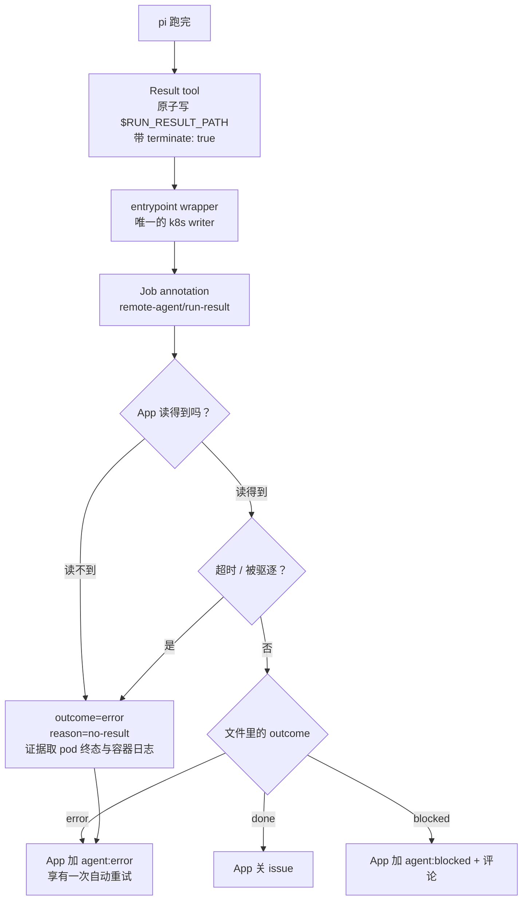
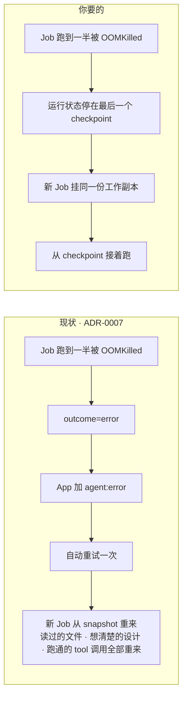

# 架构图集

本文件把**已经定下来的设计**（`README.md` + `docs/adr/`）画成图，方便对照代码与排查。

图里的名词一律取自 `GLOSSARY.md`。与 ADR 不一致的地方不在这里偷偷改，集中在[第 8 节](#8-两处缺口)列出。部署面与 OmniRoute 接线的**已定事实**（namespace、RBAC、secret、镜像、Job env、provider 接线）另在 [`docs/deployment.md`](deployment.md)，不在这里重画。

> **⚠️ 部分图已过期（[ADR-0008](adr/0008-durable-runtime-base.md)）**：执行面基座从 `pi -p --mode json` 换成了 pi-durable（库）+ 自写 runner，因此**第 1、2、6、7 节的图**与**第 8 节的缺口 A** 不再成立：Base PVC / Sync Job / Job snapshot 已退出 v1，终态只有三种（Job `Complete` / `backoffLimit` 耗尽 / `DeadlineExceeded`），pod 重启对 GitHub 不可见，`error` 不再自动重试。**第 3 节的 Spec 循环图另有两处失效（[#16](https://github.com/2017fighting/remote-agent/issues/16)）**：收尾 Job **不再跑 e2e**（`/implement-spec` 原文里没有 e2e，v1 不自行加），`Closes #<spec>` **不由 commit 带**，而是 App 开 PR 时追加进 PR body（ADR-0002 下 agent 不碰 GitHub）。重画归属 spec 阶段（见地图的「Not yet specified」）；在此之前以 `docs/adr/0003`、`0004`、`0005`、`0007`、`0008` 为准。

## 1. 系统全景



三条边界值得记住：

- **App 是唯一的 GitHub writer**（ADR-0002）。Job 只推 commit 和写自己的 annotation。
- **Sync Job 是 Base PVC 唯一的写者**（ADR-0006）。Agent Job 只见快照，所以同步不需要排空正在跑的 Job。
- **reconcile 有三个唤醒源，不是轮询**：webhook、Job watch、resync tick 每 5 分钟一次（[ADR-0014](adr/0014-wake-surface-periodic-resync.md)）。三者都只是「去跑一轮 pass」的信号，落点都是同一个 `reconcile()`；同一时刻只跑一轮，期间的触发合并成恰好一次后续 pass；tick 不引入控制面状态（[ADR-0001](adr/0001-stateless-reconciler.md)），失败的轮不自排。

## 2. 一次 ticket 运行



同步失败直接标 `error`，**不降级用旧 base**（ADR-0006）。这是有意的：一次瞬时网络抖动废掉一次运行，比让 agent 从过期的 main 起分支便宜。

## 3. Spec 循环

Spec 不会一次性实现完。App 每收到一次运行完成，就重算 Frontier，实现下一张。



收尾 Job 判断有真阻塞时走 `agent:blocked`；判断还有活没干完时，它在 spec 下**新建 sub-issue**（AFK 可实现就带 `ready-for-agent`，否则带 `ready-for-human`），下一轮 reconcile 会把它算进 Frontier。

## 4. 状态机

状态机只有**两个**能移动 label 的入口：**App 的 reconcile** 和**人的手**。第三种变化源——k8s 重启 pod——**对 GitHub 不可见**，这是本节最容易读错的地方。

### 4.1 三条硬规矩

| 规矩 | 含义 | 出处 |
|---|---|---|
| **Job 终态只有三种** | `Complete`（runner 自述 done/blocked 后已写 annotation）、`Failed(reason=BackoffLimitExceeded)`、`Failed(reason=DeadlineExceeded)`。三者之外没有「运行结束」。 | [ADR-0008](adr/0008-durable-runtime-base.md) |
| **pod 层失败不留痕** | `OOMKilled` / 驱逐 / `SIGTERM` / `CrashLoopBackOff` / init container 播种失败 → k8s 重启 pod → 同卷 `resume()`。GitHub 上**一个字都不变**。 | [ADR-0007](adr/0007-run-result-contract.md) / ADR-0008 |
| **`error` 是人的入口** | App 从不重建 Job、从不自动重试；重试的粒度是「k8s 重启 pod」，不是「App 起新 Job」。 | ADR-0008 |

App 判 Job 终态只读 `Job.status.conditions`（`Complete` / `Failed` + `reason`），**不读 pod 状态**——pod 的终态不说明任何事。「在跑」按[第 5 节](#5-并发slot-与-defer)的 Slot 口径判：Job 名下还有未到终态的 pod（`Terminating` 也算），它因此继续占着 Slot。

### 4.2 Frontier 与 Gate

```
Gate(issue) ⟺ open ∧ 无 open blocker ∧ 有 ready-for-agent ∧ 有 agent:implement ∧ 无任何 agent:*
Claim-gate(spec/ticket) ⟺ Gate ∧ 确定性名下无 Job 对象（终态与否）
Frontier(spec) = 该 spec 的 sub-issue 里第一条通过 Claim-gate 的
```

四条各自挡一类错：

- `open` + 无 open blocker：活还没干完、依赖还没清。
- **`ready-for-agent`**：人声明过它可以 AFK。**spec 收尾后把它换成 `ready-for-human`，就是靠这一条退出门**——所以 spec 不需要 `agent:in-progress` 也能停住。
- **`agent:implement`**：人授权过。「人授权过」不等于「此刻在跑」，所以 **App 永不删它**。
- **无 `agent:*`**：`in-progress` 说此刻被占着，`error` / `blocked` 说该人接手。三个都是 exit 标记，不是 entry 标记。

**assignee 不在门里。** App 设不了自己当 assignee（GitHub 不保证 bot 账号可被 assign），而 Claim 本来就是「App 写 `agent:in-progress`」那一次 label edit，去重靠它 + 确定性 Job 名。assignee 留给人自己用，App 不读也不写。

**门还有 k8s 半边（[ADR-0013](adr/0013-claim-gates-on-job-absence.md)）。** 重入 / 重开后旧 Job 大概率还在自己的保留窗里（[ADR-0012](adr/0012-job-deletion-ttl.md)），create-if-absent 会撞上它：新一轮起不来，或上一轮的 annotation 被当成新结果。所以 **Claim 的门在 label 之外还看 k8s：该 ticket 确定性名下的 Job 对象还存在（终态与否），本轮就不 Claim、不建、不读那条 annotation，等它的 `DELETED` 事件唤醒下一次 reconcile。** 这条「已终态旧 Job 在」⇒「annotation 已被消费」靠的是不变的消费时序：App 只在把票迁出 `agent:in-progress` 的那一次 reconcile 里读它，离开 T3 的前提就是 outcome 已消费。

等待与 Defer 同形：不改 label、不建 Job、不评论，只打一行日志；不吃 Slot（终态 Job 名下没有未到终态的 pod）。它顺带收掉两个崩窗：人在 Job 跑动中手滑摘了 `agent:*`（门内 ∧ Job 活着，最迟 3h deadline + 30min TTL 后 `DELETED` 唤醒重新 Claim，同卷接续）；上一次 Claim 在「建 Job」与「写 label」之间崩掉的残留（写序因此定为先建 Job 后写 label）。spec 收尾 Job（S2）同规则：`implement-spec` 名下对象还在就不起。

**逃逸口**：等不及的人可以 `kubectl delete job <名>`——删除事件立即唤醒 Claim，不用等满 30 分钟保留窗。

### 4.3 Ticket

| 状态 | Job 终态 · annotation | label（issue 状态） | 谁写的 | 进入条件 | 离开条件 |
|---|---|---|---|---|---|
| **T0** 人定出 | — | `open` · `[]` | 人 / 交互 agent | — | 加 `ready-for-agent` |
| **T1** 可 AFK | — | `open` · `[ready-for-agent]` | 交互 agent | T0 | 人加 `agent:implement` |
| **T2** 已授权 · 在门内 | — | `open` · `[ready-for-agent, agent:implement]` | 人 | T1，或人从 T5/T6 重入（T8） | App：Claim + 起 Job（T3）；Slot 满或名下旧 Job 未删则等（label 一字不变，只写一条日志） |
| **T3** 被占 · 跑着 | 非终态（`Pending` / `Running`） | `open` · `[ready-for-agent, agent:implement, agent:in-progress]` | App（先 create-if-absent Job、后写 label，[ADR-0013](adr/0013-claim-gates-on-job-absence.md)） | T2 ∧ Slot 够 ∧ 名下无未删旧 Job | 见 T4–T6 |
| **T3L** 自环 · pod 在重启 | 非终态（pod 重启，`resume()` 从 checkpoint 续） | **与 T3 一字不差** | k8s（无人写 GitHub） | 任何 pod 层失败 | 回到 T3，直到 Job 终态；`backoffLimit` 耗尽才走 T6b |
| **T4** done | `Complete` · `{outcome:"done", summary, commentBody?, newTickets?}` | `closed` · `[ready-for-agent, agent:implement]` | App（关票、摘 `agent:in-progress`；`commentBody` 有则转成评论） | T3 ∧ Complete ∧ done | 终态，出局。`newTickets` 非空时**先建 sub-issue、再关票**（反过来会在两写之间留下「票已关、新票还没建」的空窗） |
| **T5** blocked | `Complete` · `{outcome:"blocked", commentBody}` | `open` · `[ready-for-human, agent:implement, agent:blocked]` + 评论 | App（摘 `ready-for-agent`、加 `ready-for-human`、加 `agent:blocked`、置评论） | T3 ∧ Complete ∧ blocked | 人重入（T8） |
| **T6a** error · 自述 | `Complete` · `{outcome:"error", summary}` · **无 `reason`**（防御分支：ADR-0007 下 agent 只自述 done/blocked，载荷里也没有 `reason`——细分原因是 App 证据评论的事） | `open` · `[ready-for-human, agent:implement, agent:error]` + App 评论 | App | T3 ∧ Complete ∧ error | 人重入（T8） |
| **T6b** error · backoff 耗尽 | `Failed` · `reason=BackoffLimitExceeded` · **无 annotation** | 同 T6a | App | T3L 超过 `backoffLimit` | 人重入（T8） |
| **T6c** error · 超时 | `Failed` · `reason=DeadlineExceeded` · **无 annotation** | 同 T6a | App | T3 跑过 `activeDeadlineSeconds` | 人重入（T8） |
| **T6d** error · no-result | `Complete` · annotation **缺失或不可解析** | 同 T6a | App | Job 已终态却读不到 annotation（ADR-0007 兜底） | 人重入（T8） |
| **T6e** error · no-job | Job **不存在** | 同 T6a | App | label 有 `agent:in-progress`，但确定性 Job 名在 k8s 里不存在（可用性兜底：App 宕机超过 Job 保留窗被 TTL 清掉、人手动删、灾难恢复） | 人重入（T8） |
| **T8** 人重入 | — | `open` · `[ready-for-agent, agent:implement]` | 人（摘 `agent:blocked` 或 `agent:error`，`ready-for-human` → `ready-for-agent`） | T5 或 T6a–e | 回到 T2（下一次 reconcile 重新 Claim） |



### 4.4 那个自环：Job 在跑，票却一动不动

```
Job: Running
  └─ pod: OOMKilled / Evicted / SIGTERM / CrashLoopBackOff
       └─ k8s 拉起新 pod（同一块 Ticket PVC，ReadWriteOncePod）
            └─ runner 打开同一份 durable storage，resume() 从每个 task 的最后一个 checkpoint 接着跑
```

这条链上**没有一个环节碰 GitHub**：label 停在 `agent:in-progress`、票不开不关、没有评论；Slot 继续占着（Job 名下仍有未到终态的 pod，`Terminating` 也算）。所以从 issue 上看，它和「正在进行一次很慢的运行」完全一样——**这正是它该有的样子**：pod 的终态不是结果，Job 的终态才是。

两个具体后果：

- `CrashLoopBackOff` 期间你在 issue 上什么都看不到，唯一可见的信号是 Job 自己的 `status`（`reason=BackoffLimitExceeded` 出现前一直是 `Running`）与 pod 的 `restartCount`。要看进展只能 `kubectl get pods` / `kubectl logs`。
- **不要用 pod 的状态去修 label。** 「pod 挂了」不是 `error` 的证据，只有 Job 进终态才是；手动把一个还在自环里的票改成 `agent:error`，会让 App 去判一个仍然活着的 Job（T6e 的漂移分支），等于把人造的噪音塞进兜底路径。

### 4.5 Spec

| 状态 | Job 终态 · annotation | label（issue 状态） | 谁写的 | 进入条件 | 离开条件 |
|---|---|---|---|---|---|
| **S0** 已声明 | — | `open` · `[ready-for-agent]` | 交互 agent | — | 人加 `agent:implement` |
| **S1** 循环中 · 在门内 | 本 spec 下某张 ticket 的 Job（也可能此刻没有 Job） | `open` · `[ready-for-agent, agent:implement]`，**全程不变**——spec 上从不写 `agent:in-progress` | 人（只写过那一次 `agent:implement`） | S0，或人重入（S6） | 每轮 reconcile 三选一：frontier 非空 → Claim 一张 ticket（走 ticket 的 T2→T3）；frontier 空 **∧** 无 open sub-issue → 起收尾 Job（S2）；有 open sub-issue 但 frontier 空（票都 blocked / error）→ 什么都不做，只写日志。Slot 满 → Defer |
| **S2** 收尾中 | 收尾 Job（`implement-spec`）非终态 | 同 S1 | App（create-if-absent，确定性 Job 名） | S1 的第二个分支 | Job 终态 → S3 / S3N / S4 / S5 |
| **S3** 已开 PR | `Complete` · `{outcome:"done", newTickets:[]}` | `open` · `[ready-for-human, agent:implement]` + PR（commit 带 `Closes #<spec>`，body 带证据） | App（摘 `ready-for-agent`、加 `ready-for-human`、开 PR；PR 按分支 `agent/spec-<n>` 唯一，重复开是幂等跳过） | S2 ∧ done ∧ 无 newTickets | 人 merge → `Closes` 自动关票（出局） |
| **S3N** 回填新票 | `Complete` · `{outcome:"done", newTickets:[…]}` | `open` · `[ready-for-agent, agent:implement]`（不变） | App（建 sub-issue，**不开 PR**） | S2 ∧ done ∧ newTickets 非空 | 回到 S1，新票进 frontier |
| **S4** 阻塞 | `Complete` · `{outcome:"blocked", commentBody}` | `open` · `[ready-for-human, agent:implement, agent:blocked]` + 评论 | App | S2 ∧ blocked | 人重入（S6） |
| **S5** 出错 | `Failed(BackoffLimitExceeded)` / `Failed(DeadlineExceeded)` / `Complete` 无 annotation / Job 不存在（漂移） | `open` · `[ready-for-human, agent:implement, agent:error]` + 评论 | App | S2 ∧ 上述任一 | 人重入（S6） |
| **S6** 人重入 | — | `open` · `[ready-for-agent, agent:implement]` | 人（摘 `agent:blocked` / `agent:error`，`ready-for-human` → `ready-for-agent`） | S4 / S5 | 回到 S1 |



三处与旧版不同，值得记住：

1. **spec 上不再有 `agent:in-progress`。** spec 的「在跑」不是一次 Job 而是一段循环，用 label 表达它就得维护一个不进 Gate 的状态。Gate 已经够了：在门内 + frontier 空/非空就是全部信息。`agent:in-progress` 因此只有一个意思——**这张 ticket 此刻被一个 Job 占着**。
2. **ticket 的 error / blocked 不改 spec 的 label。** spec 只是因此失去 frontier，停在 S1 的空转分支；人不处理那张票，整个 spec 就停在那儿。
3. **收尾 Job 报 `newTickets` 时不开 PR**（S3N）：它在说「还有活没干完」，此时开 PR 等于宣称 spec 完整。旧 README 第 12 条只说了要建 sub-issue，没说清 PR 这一半。

### 4.6 每个 error / blocked 终态都留一条评论

annotation 只有 runner 在**终态**才写，所以 T6b/T6c/T6d/T6e 这四条路上**根本没有 annotation**——人看到的就是一个光秃秃的 `agent:error`。所以 App 在这四种情况下自己发一条评论，内容固定为：

- `outcome=error` 与 App 自己判的 `reason`（`backoff-exhausted` / `deadline-exceeded` / `no-result` / `no-job`）——**`reason` 不在载荷里**（[ADR-0007](adr/0007-run-result-contract.md)：agent 不能自述 `error`），它是 App 从 Job 终态与「annotation 有没有」得出的；
- Job 名、pod 名；
- **重入提示（[ADR-0013](adr/0013-claim-gates-on-job-absence.md)）**：人重入后，若旧 Job 还在保留窗里，新一轮最迟 30 分钟内起跑；等不及可 `kubectl delete job <Job 名>`，删除事件立即唤醒 Claim；
- pod 终态证据（`OOMKilled` / `exitCode` / `DeadlineExceeded`）与容器日志末尾；
- 这个 ticket 的 Ticket PVC 名（storage 里的对话全文在这儿）与 `kubectl logs` 指引，以及**这块卷的保留期**（`remote-agent/expires-at`，[ADR-0011](adr/0011-ticket-pvc-recycling.md)：`blocked` / `error` 留 30 天）。要提醒的是卷上**可能有未 push 的 commit**——`backoffLimit` / `DeadlineExceeded` / `no-result` 三条路上 runner 可能还没 push，卷是那部分工作的唯一副本。

`blocked` 与 `done` 走 agent 自述的 `commentBody`；agent 没给 `commentBody` 时 App 退回同一份模板。**`error` 没有自动重试，这条评论就是人唯一的入口提示。**

## 5. 并发：Slot 与 Defer



两个语义容易混：

- **Slot 不是 Guardrail quota**。Slot 是 App 算出来的并发名额；Guardrail quota 是 namespace 里只算对象数量的 ResourceQuota，防的是 App 逻辑写错时无限起 Job，不承载并发语义。
- **Job 只要名下还有未到终态的 pod 就占着 Slot**，无论那个 pod 是否正在终止。所以删除卡在终止的 pod 不会立刻释放名额。

## 6. Base PVC 与 Job snapshot 的生命周期



Base PVC 写坏时**不删 PVC**：按 truenas-csi 的语义，源卷被删时 `deletionPolicy: Retain` 也保不住旧快照。自愈信号是 base PVC 上的 `remote-agent/reseed` annotation（ADR-0006）。

## 7. Run result 与 Outcome 判定



`outcome` 描述**这次运行是怎么结束的**，不描述为什么没做成（后者在 `reason` 里，不进枚举、不进状态机）。

两条判定压过文件内容：**超时与驱逐压过文件里的 `done`**（被 deadline 打断的运行 commit/push 未必走完，认 done 会让 App 去 close 一个并未真正完成的 issue）；**App 对已终态但读不到 result 的 Job 兜底判 `error`**。因此 **Job 与它的 pod 在 App 成功读到 result 之前不得被删**。

用了 `terminate: true` 之后，本次 run 最后一条 assistant 消息的 `stopReason` 是 `toolUse`，所以 wrapper 判 pi 层失败只能用「最后一条 assistant 的 `stopReason ∈ {error, aborted, length}`」。

## 8. 两处缺口

以下两点是**你提的需求与现有 ADR 之间真实存在的差距**，不是实现细节。按 `docs/agents/domain.md` 的要求显式列出。

### 缺口 A：崩溃后是「重跑整个 ticket」，不是「接着之前跑」

> **已解决（[ADR-0008](adr/0008-durable-runtime-base.md)）**：基座换成 pi-durable 后，崩溃/被驱逐是 k8s 重启 pod + 同一块 Ticket PVC 上 `resume()` 从最后一个 checkpoint 接着跑，「重跑整个 ticket」不再成立。下面的现状描述只对 pi CLI 时代成立，保留作背景。

现状由 ADR-0007 决定：一切非 agent 自述的失败（OOM、被驱逐、超时、pi 的 `stopReason ∈ error|aborted|length`）都归为 `outcome=error`，享有一次自动重试。重试是 App 起一个**新 Job、从同一份 Job snapshot 重新开始**。



要「接着跑」，需要两样现在都没有的东西：

1. **一次运行的工作副本跨 Job 存活**。现在的 Job snapshot 是一次性的，Job 结束就没有家。
2. **运行时自己的 checkpoint**。`pi -p --mode json` 没有——它是一次性的 print 运行。

触动的 ADR：**0003**（一个 ticket 一个 Job，工作副本来自一次性快照）、**0006**（快照必须打在静止的 base 上）、**0007**（`error` 的语义与重试的粒度）。

一个候选是 `@earendil-works/pi-durable`（实验性）：它把一次运行拆成 task 状态机，每步 `runtime.commit()` 落 checkpoint，进程崩溃后 `resume()` 从最后一个 checkpoint 接着跑，副作用靠 `runtime.memo()` 挡重复。代价是换掉 `pi -p --mode json` 这个运行时，ADR-0007 那套结果契约要重做——pi-durable 有自己的 submission / outcome 模型，不需要 `run_result` 工具与 annotation 那层 wrapper。

### 缺口 B：运行中无法观察，也没有介入通道

现状：App 只在 Job 终态时读 annotation。运行中你只能 `kubectl logs`，或者等它结束。ADR-0002 明确接受这个代价（「Job 不能直接跟人对话」）。

要「看到它跑到哪了、接着它之前的跑」，需要：Job 在跑的时候暴露一个可读通道，Job 不在的时候还能把它的状态读出来。这跟三条 ADR 有张力：

- **ADR-0001**：无状态 reconciler，没有地方存「哪个 ticket 现在能看到什么」的索引。任何跨 reconcile 的索引都要重新论证。
- **ADR-0002**：App 是唯一 GitHub writer。人的介入（steer、改 prompt、重跑）会成为第二个 writer，需要重新划界。
- **ADR-0007 / ADR-0012**：Job 在 App 读到 result 之前不得被删——这条已被改写成「TTL 1800 秒 = App 的读取预算」（[ADR-0012](adr/0012-job-deletion-ttl.md)）。观察通道会延长这个保留窗口。

**这里还有一个词汇缺口**：这个能力在 `GLOSSARY.md` 里没有名字。按 `docs/agents/domain.md`，不要直接造词——留给 `/domain-modeling` 定名，再开 ADR。

## 9. 与先前草图的差异

本项目立项前的若干草图中，有三点与本仓库已定的 ADR 不符，记录在此以免混淆：

| 草图里的说法 | 与哪条 ADR 冲突 | 正确的说法 |
|---|---|---|
| control-plane 持有 `index.sqlite` | ADR-0001 无状态 reconciler | App 不保存控制面状态；GitHub issue 状态与 k8s Job 列表就是唯一真相 |
| attach pod 作为第二种 pod | ADR-0003 一个 ticket 一个 Job | 目前只有 Agent Job 与 Sync Job 两种；运行中观察是缺口 B |
| Job 通过 `onReport` 上报给 App | ADR-0002 App 是唯一 GitHub writer | Job 只推 commit、只写自己的 annotation；App 主动来读 |
| 轮询 GitHub API 作为触发 | ADR-0014 把 resync tick 定为第三条唤醒源 | 有周期 tick，但它只当「去跑一轮 pass」的信号：不重算、不持有状态、同一时刻只跑一轮（[ADR-0014](adr/0014-wake-surface-periodic-resync.md)） |
